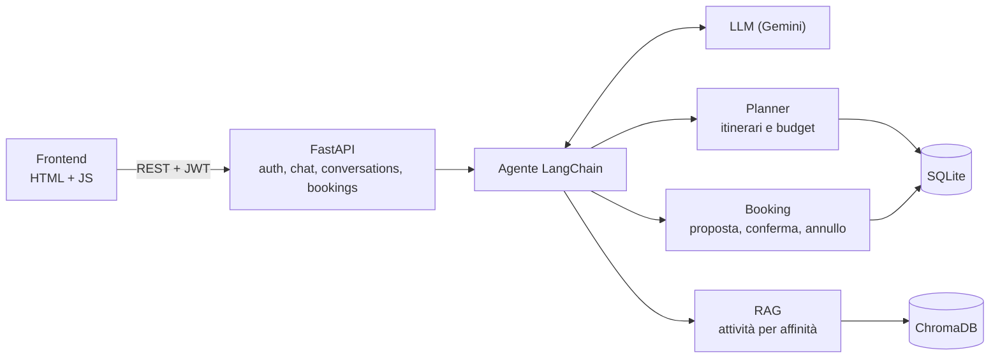
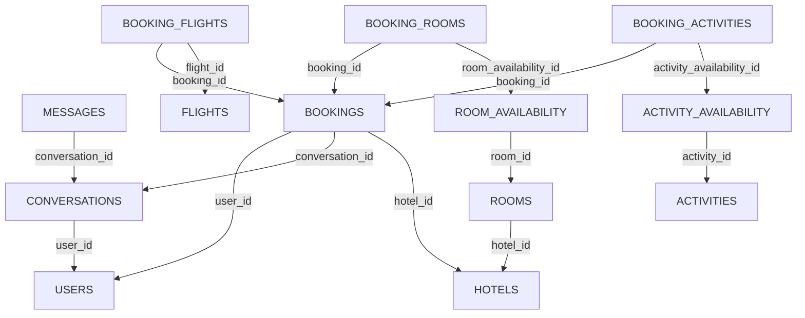

# Virtual Travel Assistant

Assistente virtuale conversazionale per organizzare viaggi. L'utente indica in chat budget, nazione, preferenze sulle attività, mese e numero di viaggiatori; l'assistente propone itinerari completi (volo di andata e ritorno, un hotel per ogni notte e un'attività per ogni giorno) nel rispetto del budget e delle disponibilità. L'itinerario scelto si prenota direttamente dalla chat e le prenotazioni sono consultabili in una dashboard dedicata.

## Stack

| Parte | Tecnologie |
|---|---|
| Backend | Python 3.11, FastAPI, SQLAlchemy 2, SQLite |
| Ricerca semantica (RAG) | ChromaDB come database vettoriale; embedding con `gemini-embedding-001` (default) oppure `paraphrase-multilingual-MiniLM-L12-v2` in locale (Hugging Face) |
| Agente | LangChain con `gemini-3.5-flash-lite` (default); da configurazione si possono scegliere Groq (`openai/gpt-oss-120b`) o Hugging Face (`HuggingFaceTB/SmolLM-135M`) |
| Autenticazione | JWT, password con bcrypt |
| Frontend | HTML, CSS e JavaScript semplice|
| Test e osservabilità | pytest, log su file, tracing opzionale con Phoenix |

## Architettura

Due app indipendenti: un'API REST (`backend/`) e un frontend statico (`frontend/`) che la chiama con `fetch` mandando il token JWT.



Flusso di un messaggio: il backend carica la cronologia della chat e la passa all'agente, che chiama i propri tool (planner, RAG, prenotazioni) e risponde in italiano. Messaggi e itinerari proposti vengono salvati nel database, e le chat precedenti si possono rileggere dallo storico (in sola lettura).

```
backend/
  app/
    auth/           registrazione, login, utente corrente
    chat/           POST /api/chat
    conversations/  elenco e dettaglio delle chat
    bookings/       elenco, dettaglio, conferma e annullo
    services/       planner, rag, booking, agent, agent_tools (la logica vera)
    models/         tabelle SQLAlchemy
    schemas/        modelli Pydantic
    core/           configurazione, log, tracing
  db_scripts/       seed dei dati e indicizzazione su Chroma
  tests/            test automatici
  config.yaml       provider, modelli e parametri
frontend/           
  style/
  js/ (un file per vista)
  index.html
```

## Database

SQLite, con chiavi esterne attive e vincoli a livello di schema (unicità camera+notte e attività+giorno, contatori mai negativi).

- **Utenti, conversazioni, messaggi.** Ogni conversazione conserva i requisiti raccolti finora (budget, nazione, ecc.) e i messaggi scambiati dall'utente.
- **Catalogo.** Voli (con data e posti rimasti), hotel, camere, attività.
- **Disponibilità a righe per data.** Una riga per camera e notte (con prezzo e se è libera) e una per attività e giorno (con i posti rimasti). Prenotare vuol dire consumare queste righe.
- **Prenotazioni.** Una riga generale più tre tabelle figlie (voli, camere per notte, attività per giorno) che puntano alle righe di disponibilità e conservano i prezzi del momento della proposta.

ChromaDB contiene un documento per attività, con lo stesso id della tabella SQL. È un indice derivato: se cambiano le attività si rigenera con `index_vectors`.



Ogni freccia va da una tabella a quella che richiama, con il nome della colonna che le collega. I prezzi di voli e attività sono per persona, quelli delle camere per camera e per notte. Lo schema completo, con tutte le colonne, è in [docs/db-diagram.md](docs/db-diagram.md).

## Logiche interne

**Planner (`services/planner.py`).** Non usa l'LLM e lavora in sola lettura sul database. Per la nazione richiesta enumera le combinazioni di volo di andata, volo di ritorno e hotel nel mese scelto, seleziona le camere meno costose che ospitano tutti i viaggiatori, assegna un'attività diversa a ogni giorno (come problema di abbinamento, in modo che un giorno con poche opzioni non resti scoperto a causa di scelte precedenti) e scarta le soluzioni che superano il budget. Restituisce due itinerari in evidenza ("Più adatto a te" e "Più economico") e alcune alternative. Se non trova soluzioni ne indica il motivo e, se il limite è il budget, il costo minimo necessario.

**RAG (`services/rag.py`).** Ordina le attività in base alle preferenze dell'utente (ad esempio "musei", "qualcosa di romantico", "avventura"). Esegue una ricerca per similarità per ogni preferenza e applica una soglia minima di affinità (che cambia in base al provider del modello di embedding), per non proporre attività poco pertinenti.

**Prenotazione in tre stati.** `proposed` (salvata dalla chat), `confirmed` e `cancelled`. La conferma scala i posti di voli e attività e occupa le camere in un'unica transazione: se anche una sola risorsa non è più disponibile, non viene modificato nulla. L'annullamento esegue l'operazione inversa.

**Agente (`services/agent.py`, `agent_tools.py`).** Dispone di tool in sola lettura per assistere la scelta (destinazioni, hotel, aeroporti, date dei voli, attività), di uno per generare gli itinerari e di altri per salvare, confermare e annullare. Confermare e annullare sono azioni con effetto reale, quindi il prompt impone di eseguirle solo su richiesta esplicita dell'utente.

## Note e decisioni di progetto

- **L'LLM non decide mai prezzi, date o disponibilità.** Sono calcolati dal planner con query SQL; l'LLM sceglie tra le proposte e le spiega. I numeri sono quindi sempre corretti e il planner è testabile senza alcun modello.
- **Il DB in SQLite è la fonte primaria.** Chroma serve a ordinare le attività per affinità, ma disponibilità e prezzo di ogni attività proposta sono sempre verificati nel DB.
- **Disponibilità modellata con una riga per data**, invece di contatori generici. Il modello è più verboso, ma rende la conferma semplice e sicura (un `UPDATE` condizionato per riga) e permette di sapere con precisione cosa libera un annullamento.
- **Il contesto della chat viene ricostruito dal database a ogni richiesta.** Gli ultimi itinerari mostrati e l'ultima proposta sono salvati nel DB, così richieste come "prendo il primo" o "conferma" hanno un riferimento chiaro nel messaggio successivo, anche dopo un riavvio del server.
- **Autenticazione senza sessioni.** Il server firma un JWT al login e il frontend lo invia a ogni richiesta. Le password sono salvate solo come hash bcrypt.
- **Configurazione separata.** `config.yaml` contiene provider, modelli e parametri; `.env` solo segreti e percorsi. Cambiare LLM o provider di embedding richiede la modifica di una riga.
- **Periodo di viaggio e numero di notti.** L'utente indica il mese; le date esatte sono scelte dal planner in base ai voli disponibili. La durata è decisa dall'utente (7 notti di default).
- **Dati sintetici.** Città, voli, hotel e attività sono dati di prova generati dallo script di seed. Le principali destinazioni sono in Europa.
- **Fuso orario non gestito.** Il planner lavora sulle date dei voli (partenza e arrivo) senza considerare il fuso orario: se partenza e arrivo sono in fusi diversi, il giorno di arrivo potrebbe non essere corretto. Anche "da domani in poi" si basa sulla data del server.
- **Una sola attività al giorno.** Ogni giorno del viaggio ha esattamente un'attività, senza fasce orarie né tempi di spostamento. Se le attività diverse non bastano per tutti i giorni, se ne ripete una. L'ultimo giorno non include attività.
- **Un'attività viene proposta anche se poco affine.** L'affinità serve a ordinare le attività, non a escluderle: ogni giorno ne ha sempre una, anche se il suo punteggio è basso. La soglia minima di affinità vale solo per i risultati dello strumento di ricerca. L'alternativa sarebbe stata lasciare giorni senza attività o proporre solo plan veramente affini (ma poco realistico se ci sono poche attività). 
- **Prezzi uguali per tutti.** Voli e attività costano lo stesso a ogni viaggiatore (nessuna differenza tra adulti, bambini e neonati) e le camere si scelgono solo per capienza.
- **Le proposte non bloccano la disponibilità.** Salvare una proposta non occupa voli, camere né attività: solo la conferma scala i posti. Una proposta può quindi non essere più confermabile se nel frattempo qualcun altro ha prenotato le stesse risorse; in quel caso la conferma fallisce e non cambia nulla. Le proposte non hanno una scadenza.
- **Limiti di viaggiatori e notti.** Al massimo 8 viaggiatori e da 1 a 14 notti (7 di default). I valori si cambiano in `config.yaml` (`max_travelers`, `min_nights`, `max_nights`, `default_nights`).

## Come runnare

Servono Python 3.11+ e una chiave API di Google AI Studio (Gemini).

```
# 1. Ambiente e dipendenze (dalla cartella del progetto)
python -m venv .venv
.venv\Scripts\activate
cd backend
pip install -r ..\requirements.txt

# 2. Segreti: copia il file di esempio in backend/.env e inserisci lì le chiavi API: GEMINI_API_KEY (sempre necessaria
#    con la configurazione di default), GROQ_API_KEY o HF_TOKEN solo se scegli quei provider in config.yaml,
#    e una SECRET_KEY lunga e casuale
copy .env.example .env

# 3. Dati di prova e indice vettoriale (sempre da backend/)
python -m db_scripts.seed               # crea il database; utente demo: demo@example.com / demo1234
python -m db_scripts.index_vectors      # indicizza le attività in ChromaDB

# 4. Server API: http://localhost:8000 (documentazione su /docs)
uvicorn app.main:app --reload
```

In un secondo terminale, il frontend:

```
cd frontend
python -m http.server 5173           # http://localhost:5173
```

Test (da `backend/`): `pytest`. Usano un database e un indice temporanei, non toccano i dati e non chiamano nessun LLM vero (l'agente è testato con un modello finto).

Note:
- Lancia sempre i comandi da `backend/`: i percorsi di database e indice sono relativi.
- Il piano gratuito di Gemini permette 100 embedding al minuto: se `index_vectors` li supera, aspetta un minuto da solo e riprova.
- `reseed: false` in `config.yaml` impedisce al seed di cancellare un database che ha già chat e prenotazioni. Per rifarlo da zero mettilo a `true`, lancia lo script e rimettilo a `false`.
- **Tracing (opzionale, spento di default).** Con `tracing_enabled: true` in `config.yaml` le chiamate dell'agente (modello e tool) vanno a [Phoenix](https://github.com/Arize-ai/phoenix) su `http://localhost:6006`. Il server Phoenix è già tra le dipendenze: si avvia a parte, in un secondo terminale, con `phoenix serve`. Se lo accendi senza il server, l'app funziona lo stesso ma nel log compaiono errori di connessione.
