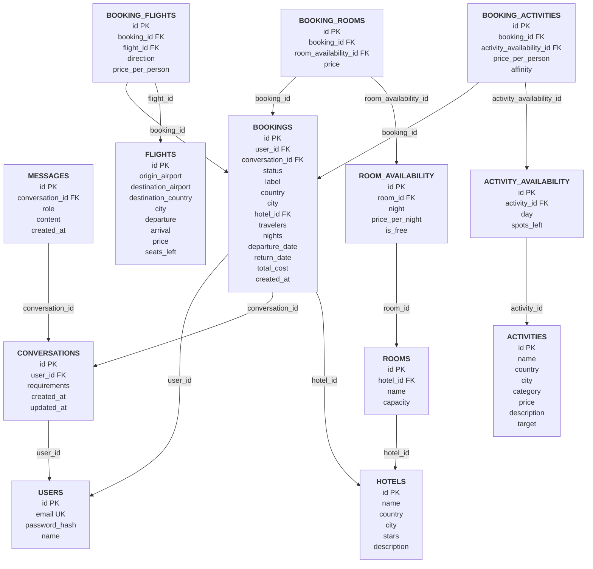

# Schema del database

Schema implementato in `backend/app/models/models.py`.

Ogni riquadro è una tabella con le sue colonne (PK chiave primaria, FK chiave esterna, UK valore unico). Ogni freccia va da una tabella a quella che richiama e porta il nome della colonna che le collega (per esempio `BOOKINGS --user_id--> USERS` significa che la prenotazione contiene l'id dell'utente).

## Note sul diagramma

- **`BOOKINGS`**: una riga per prenotazione con i dati generali; il dettaglio sta nelle tabelle figlie `BOOKING_FLIGHTS` (andata e ritorno), `BOOKING_ROOMS` (una riga per camera e notte) e `BOOKING_ACTIVITIES` (una riga per attività e giorno), con chiave esterna verso le righe di disponibilità: confermare e annullare toccano quelle righe. I prezzi sono quelli del momento della proposta.
- **`ROOMS`**: una riga per camera fisica; `ROOM_AVAILABILITY.is_free` dice se è ancora libera in quella notte.
- **Unicità composte**: `ROOM_AVAILABILITY(room_id, night)` e `ACTIVITY_AVAILABILITY(activity_id, day)`.
- **Stati di `BOOKINGS.status`**: `proposed`, `confirmed`, `cancelled`.
- **Unità dei prezzi**: voli e attività per persona; camere per camera (intera) e per notte.
- **Chroma** non è nel diagramma: un documento per attività, con lo stesso `id` di `ACTIVITIES.id`.