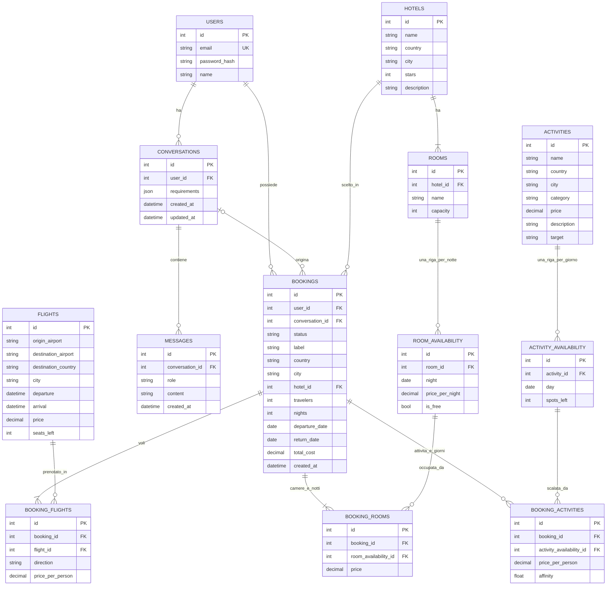

# Schema del database

Diagramma ER dello schema implementato in `backend/app/models/models.py`.

## Note sul diagramma

- **`BOOKINGS`**: una riga per prenotazione con i dati generali; il dettaglio sta nelle tabelle figlie `BOOKING_FLIGHTS` (andata e ritorno), `BOOKING_ROOMS` (una riga per camera e notte) e `BOOKING_ACTIVITIES` (una riga per attività e giorno), con chiave esterna verso le righe di disponibilità: confermare e annullare toccano quelle righe. I prezzi sono quelli del momento della proposta.
- **`ROOMS`**: una riga per camera fisica; `ROOM_AVAILABILITY.is_free` dice se è ancora libera in quella notte.
- **Unicità composte** (non disegnabili in Mermaid): `ROOM_AVAILABILITY(room_id, night)` e `ACTIVITY_AVAILABILITY(activity_id, day)`.
- **Stati di `BOOKINGS.status`**: `proposed`, `confirmed`, `cancelled`.
- **Unità dei prezzi**: voli e attività per persona; camere per camera (intera) e per notte.
- **Chroma** non è nel diagramma: un documento per attività, con lo stesso `id` di `ACTIVITIES.id`.
